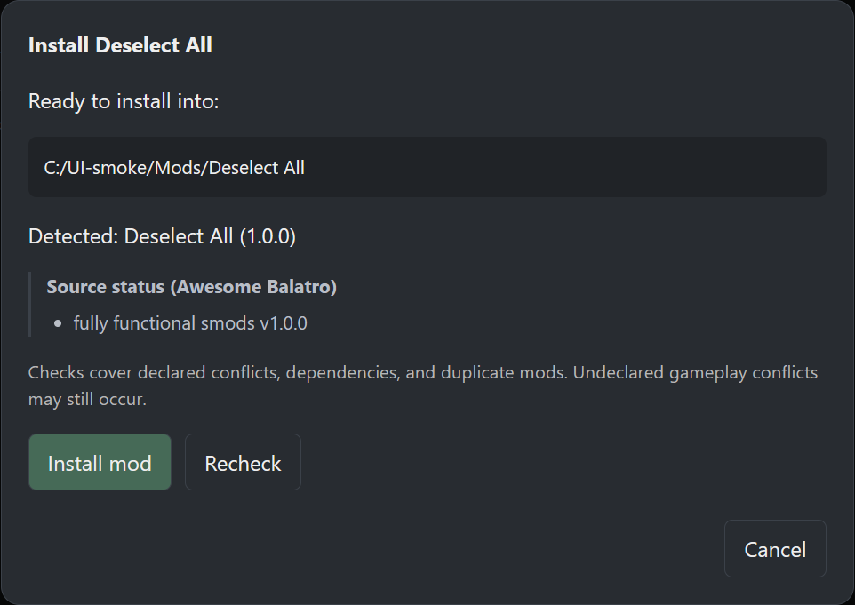

# Awesome Balatro catalog coverage

The in-app Awesome Balatro directory is generated from
[`jie65535/awesome-balatro`](https://github.com/jie65535/awesome-balatro/blob/main/README.md).
The bundled offline snapshot records README blob
`1a0335a5834f3148cd24076983d65e6e2bd195c0`, retrieved on October 23, 2026.
The directory can refresh from the raw upstream README at runtime; a failed or
unexpectedly small refresh keeps the last known-good cache or bundled snapshot.
The upstream list is published under
[CC0 1.0 Universal](https://github.com/jie65535/awesome-balatro/blob/main/LICENSE);
the snapshot retains the upstream repository, README URL, revision, and source
line for every entry.

## Snapshot coverage

| Group                                               | Entries |
| --------------------------------------------------- | ------: |
| Mods listed under the four upstream Mods sections   |     309 |
| Mod-like Tools entry (Balatro Ultimate Speedup Mod) |       1 |
| Mod loader references, shown on a separate tab      |       4 |
| Total directory entries                             |     314 |

The unfiltered 321 mod entries cover 322 source bullets. One identical Steamodded entry,
Sylvie's Silliness, appears under both Collections and Decks; it is represented
once with both categories. Nine named children of grouped entries such as
Gimmicky decks pack are retained as individual entries with their parent and
source link. The parser also accepts the upstream malformed
`[Redux-Arcanum] (url)` link.

Mod entries by listed loader:

| Loader in Awesome Balatro | Entries |
| ------------------------- | ------: |
| Steamodded                |     248 |
| Balamod                   |      30 |
| Lovely                    |      25 |
| No loader listed          |       7 |

The “no loader” count includes the six Mods (Other) entries and Balatro
Ultimate Speedup Mod. Calculators, seed searchers, managers, trackers, companion
apps, website templates, and resource links from the Tools and Resources
sections are not presented as game mods. Balamod, Lovely, NANEINF, and
Steamodded remain discoverable on the separate Loaders tab.

## Source health and GitHub stars

The public-source check at `2026-10-23T22:08:54.857Z` checked all 305 unique
Awesome primary/secondary URLs and all 588 unique GitHub repositories found in
Awesome and the primary index. Repository API responses supplied actual GitHub
`stargazers_count` values for 577 available public repositories. Eleven public
repository endpoints returned 404 twice. Those unknown counts are displayed as
unavailable rather than zero; a real checked zero remains zero. Moved
repositories retain aliases and link to their canonical GitHub location.
Counts are a dated bundled snapshot, not a continuously live popularity feed.

Of the 305 Awesome URLs, 217 were available, 11 returned confirmed 404s, and
77 Discord links were retained as access-restricted. A Discord HTML shell does
not prove a thread exists; none of those threads was deleted based on an
unauthenticated check. Timeouts, 429s, 5xx responses, authentication failures,
and other uncertain results do not trigger deletion. No uncertain network
failures occurred in this check.

The eleven unavailable Awesome entries were removed from the local snapshot:

| Entry                | Unavailable public source                                  |
| -------------------- | ---------------------------------------------------------- |
| OddityAPI            | `AutumnMood924/AutumnMoodMechanics`                        |
| The Autumn Circus    | `AutumnMood924/TheAutumnCircus`                            |
| Absolute Deck        | `Steamodded/examples/blob/master/Mods/AbsoluteDeck.lua`    |
| Deck of 4            | `Steamodded/examples/blob/master/Mods/DeckOf4s.lua`        |
| Ultimate Random Deck | `Steamodded/examples/blob/master/Mods/UltimateRandom.lua`  |
| JimboStats           | `JimboStats/jimbo-stats-mod`                               |
| Incantation          | `jenwalter666/JensBalatroCollection/tree/main/Incantation` |
| More Speed           | `Steamodded/examples/blob/master/Mods/MoreSpeeds.lua`      |
| MoreFluff            | `https://notmario.github.io/MoreFluff/`                    |
| Seven Sins           | `AlexDavies8/balatro-mods`                                 |
| Silver Seal          | `mwithington/SilverSeal`                                   |

The repository and exact source-path checks are separate: the examples
repository still exists, while those four files do not. A missing file does
not hide other working mods in that repository. The app filters known missing
sources from bundled data, old local caches, and successful README refreshes,
so an upstream stale link cannot reappear through Refresh. Dead secondary
links are also removed. Source availability is independent of installation
layout support; authors and mod names are not blocked from downloads.

To refresh the evidence and bundled index, run:

```sh
gh auth login # once, if needed
bun scripts/refresh-catalog.ts
```

The refresh uses at most twelve concurrent requests. It reads the current
README and a pinned primary-index tree, fetches each public repository's star
count, and checks each source URL. Credentials are read from the existing
GitHub CLI login, kept in memory, and sent only to `api.github.com`; they are
never written into the data files. Missing checks are repeated before pruning.
The script starts from the original README every time, allowing a restored
public source to return after a successful check. Previously confirmed missing
sources stay excluded during an uncertain follow-up check until accessibility
is established. Review the changed JSON and this coverage report before
committing an updated snapshot.

`src/lib/data/repository-metadata.json` records the check timestamp, response
status, GitHub canonical names and star counts, removed entry/source line
evidence, and the primary tree revision
`ee9c1d2dcc48530894ae61e007aa646289941f58`. Its 448 metadata files contained
two invalid JSON records (`Khasm@Friends-of-Phoenix-Wright` and
`Rageinater@Quality`), which were reported and skipped during repository
extraction. The upstream primary index was not edited.

## Installation

Awesome Balatro is a discovery source, not an installation manifest. BMM shows
“View in catalog” only when exactly one current primary-index item has both:

1. the same normalized title;
2. the same canonical GitHub owner/repository;
3. a repository-root source link rather than a file, tree, query, or anchor; and
4. a current, non-orphaned primary record carrying a verified `bmi://`
   download reference.

The directory also offers its own **Install** action for Steamodded and Lovely
mods with a supported download source. An exact current catalog match uses its
verified download reference. Other GitHub repository links resolve through
GitHub's API to their default branch; file and subtree links retain their
selected revision/path. Direct ZIP, TAR, TAR.GZ, and Lua URLs are supported.
An individual Lua mod keeps its original filename inside its own folder in the
resolved Balatro Mods directory. The package must have a recognizable loadable
layout; a GitHub repository alone is not proof that it can be installed.

For **Download from Discord**, BMM opens the listed Discord link and displays
the downloaded-file location prompt. Paste a path, use **Browse files**, or
use **Browse folders**, then choose **Check download**. Other download pages
and grouped entries use the same local import workflow. Select the individual
mod from a collection when the link points to its parent pack. The source
download stays in place. RAR/7z downloads must be extracted first and imported
as a folder.

Preparation downloads/copies into staging outside Mods. Review shows the final
destination, detected metadata, upstream source status, and compatibility warnings.
Positive badges such as “fully functional” and desktop-irrelevant notes such as
“not mobile compatible” appear as informational source status. They do not
require acknowledgement or disable installation. Upstream reports of crashes,
conflicts, experimental behavior, or needed repairs remain warnings, separate
from the checks against installed mods.
Declared conflicts are checked both from the new package and from installed
mods. Missing dependencies and unverified version constraints are called out.
Duplicate identities and occupied destinations block installation. Warnings
require acknowledgement; **Cancel** discards staging. The final install checks
the filesystem again, records the mod in BMM, and refreshes Installed Mods.
Existing installations are not overwritten by this flow; use their update or
remove controls first.

Conflict checks follow [Steamodded metadata](https://docs.smods.dev/API%20Documentation/Mod-Metadata/)
and legacy Lua headers. They cannot discover every undeclared Lua/gameplay
conflict or prove version compatibility. Lovely patches without Steamodded
metadata receive an explicit limited-check warning. Required loaders are not
silently installed as part of this flow.

Balamod, entries with no identified supported loader, and loader references
retain their setup instructions because their destination or game-patching
requirements differ. Ambiguous/unsupported GitHub layouts can be downloaded
manually and imported after selecting the actual mod folder.

JokerDisplay, other `nh6574` mods, and Joyous Spring use the same download and
package checks as other mods. Previous author/name-based exclusions are removed
from the UI, backend, bundled snapshot, and cached catalog handling.
Balatro Multiplayer retains manual setup instructions because its installation
layout is not supported by BMM's installation flow.

Runtime “in BMM catalog” and “installed” totals intentionally are not fixed in
this report. They are computed against the currently verified primary catalog
and local installation state, so the UI cannot turn an old bundled match into
an installation path. The direct-download count describes recognized source
routes, not a guarantee that every upstream link is still available or loadable.

## Verification

Windows x64 validation on October 23, 2026:

- 176 application tests, 126 library tests, and 163 frontend tests passed.
  Two opt-in network tests and three documentation examples remain ignored.
  Type checking, lint, formatting, workspace Clippy with warnings denied, and
  the production frontend build passed.
- In an isolated native Tauri profile, the directory downloaded
  `FasterStakesUnlock.lua`, preserved its basename, and registered it in BMM.
  It also installed the current Cartomancer archive through its catalog route.
- The Discord action opened the listed download link and displayed the local
  path prompt. An inert local Lua fixture declared a conflict with the installed
  Faster Stakes Unlock mod and a missing dependency; both warnings appeared,
  and installation required acknowledgement. Its installed SHA-256 matched the
  untouched source fixture. This exercises the handoff without claiming to
  download a gated Discord attachment.
- A live GitHub repository-root preparation read Cartomancer's version 4.17.8
  from its trailing-comma JSON and blocked a duplicate installation under a new
  folder name. A GitHub subtree preparation selected only Eccentric Deck.
  Cancelling both preparations removed their staging directories.
- The upstream Absolute Deck file link returned HTTP 404. BMM displayed an
  error and offered local import rather than creating an empty installation.

All installation checks used a separate `BMM_DATA_DIR`, app identifier, and
WebView profile. The user's installed manager, real mods, and game saves were
not changed. These checks verify manager behavior; in-game compatibility and
native macOS/Linux execution are not established by this Windows run.

### Source-status and download follow-up

The October 23 follow-up passed 215 frontend tests, 179 application tests, and
126 library tests, plus type checking, lint, Rust formatting, and Clippy. The
Windows x64 production build produced both NSIS and MSI installers.
The three opt-in network tests remain skipped in the standard suite; the new
JokerDisplay network test was also run explicitly. It downloaded the current
stable branch, detected JokerDisplay 2.0.6, preserved its declared conflict
metadata, and reported a missing loader in an empty isolated Mods directory.
Cancellation removed staging without installing or changing the user's mods.

A browser smoke check with a simulated desktop bridge verified that Deselect
All's “fully functional” badge is informational and leaves Install enabled,
JokerDisplay requests its GitHub download, reported crashes require
acknowledgement, and blocking conflicts cannot be overridden. The screenshot
below uses the simulated install destination; it is not an installed-mod check.


