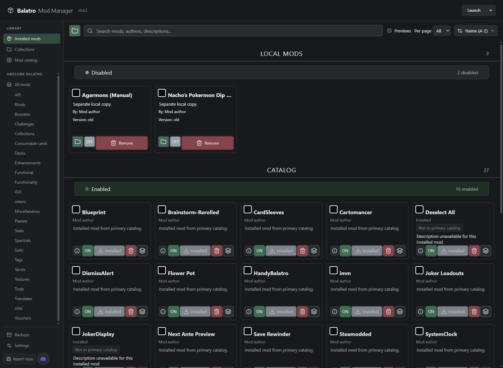

# Installed mods and game state

BMM and Steamodded use the same Balatro Mods directory. BMM's Installed list
describes files on disk and their configured enabled state. A running game
retains the mods it loaded at startup; restart Balatro after changing mods in
an external manager. Enabled does not guarantee that a mod passed Steamodded's
dependency checks or loaded successfully.

## Enabled and disabled

Steamodded and Lovely recognize two forms of disabling a mod:

- A `.lovelyignore` marker in its mod folder.
- Its folder name in `Mods/lovely/blacklist.txt`.

BMM checks both. Enabling a mod explicitly removes its ignore markers and its
matching blacklist entry; other blacklist entries retain their contents and
line endings. Missing mod paths cannot be reported as enabled. Reading the
Installed list never changes either disabling mechanism.

IMM's installed inventory includes disabled mods, and its local inventory is
loaded when the game starts. Its browser Refresh action reloads the remote
catalog without rescanning all local mods. A mod's presence in IMM's browser
does not by itself prove that it is installed or active. The installed IMM
2.0.3 implementation checks ignore markers but does not incorporate the
Steamodded blacklist, so its active status can differ from Steamodded's.

## Catalog status

**Not in primary catalog** means an installed mod has no matching record in
BMM's current primary catalog. An Awesome Balatro install or manually obtained
mod can legitimately have this status. It does not mean the files were removed,
that the mod is banned, or that the game cannot load it. BMM does not have enough
membership history to claim that every such mod was removed from an index.

Installed entries without downloadable catalog metadata show a static
description fallback instead of an indefinite loading skeleton.

## Separate copies

Different folders may contain copies of the same mod. BMM lists a separate
untracked copy as a manual installation, retaining its path for enable/disable
and uninstall actions. A similarly named sibling folder is not part of the
managed folder just because its name starts with the same text. Uninstalling
one copy does not remove other copies automatically.

Nested content inside a recognized mod package and bundled dependencies retain
their existing package-level treatment.

## Deck selection

Steamodded 26.1002.0 supplies the two-row deck grid, selected-deck preview,
Random Deck, and Last Run controls. CardSleeves adds the Select Sleeve page.
Steamodded's **Use Vanilla Run Select** option is honored only when there are
no extra selection pages; CardSleeves' additional page requires the new layout.
These controls are separate from BMM's appearance and catalog settings.

## Verification

Windows validation covers both blacklist and ignore-marker state, preserving
unrelated blacklist entries during explicit enables, missing and out-of-scope
paths, duplicate physical folders, and catalog membership refreshes. App tests
use a shared, restoring temporary environment guard so parallel test execution
cannot redirect another test into the normal profile.

The browser fixture below represents 27 tracked installations and two separate
manual copies. It verifies four blacklisted tracked mods are OFF, all installed
cards survive a fresh load, and the three missing primary-catalog records show
the neutral label without permanent loading placeholders. The fixture uses
substitute paths and descriptions; it does not access or change a game profile.

