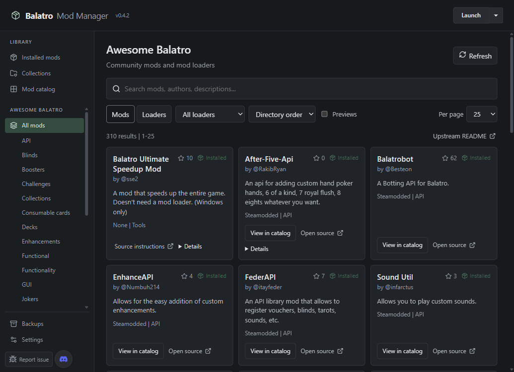

# Compact dark interface

The manager uses a solid dark background, the operating system UI font, compact
cards and controls, and an Awesome Balatro category sidebar. About and Submit Mod
navigation and components have been removed. Routine background catalog loads no
longer display success/loading notifications, and cards appear without staggered
entrance animation.

The screenshot uses the real bundled Awesome directory with a simulated desktop
bridge and test installation records; it does not represent the user's installed
mods.

## Browsing behavior

- Search filters each mod list immediately using the shared typo-tolerant fuzzy
  matcher. It covers titles, authors, descriptions, and available categories.
- Previews default to hidden. The checkbox in mod lists and mod details shares
  the persisted Settings preference, including images embedded in descriptions.
- Settings stores 10, 25 (default), 50, 100, or All mods per page. All mode renders
  the complete filtered list without pagination. Installed lists count local and
  indexed mods together; their old incremental render limit has been removed.
- GitHub-backed cards show checked repository star counts, and lists can sort by
  stars. Unknown counts remain unavailable and sort after known counts. Counts
  are a dated snapshot; see [source health](awesome-balatro-coverage.md).
- Clicking a card opens its GitHub repository inside the app when one can be resolved. Separate
  install, update, enable, uninstall, collection, and details controls retain
  their actions. A source-only entry opens its listed source instead.
- Source pages use an isolated native webview in the main app window, with Back,
  Forward, Reload, the current URL, and Close source. Closing returns to the same
  list, search, and scroll position. Links requesting a new window stay in this
  viewer. Failed opens show an in-app error without launching the system browser.
- Repeated loader variants appear as one mod card with combined categories and
  alternate sources. The loader filter selects the corresponding installation
  method. Primary catalog refreshes and display caches also consolidate proven
  duplicate identities while retaining separate repository children and physical
  installed copies.
- Awesome category navigation returns to the Mods tab even when the Loaders tab
  was previously selected. Install/import safety review remains in place.

## Verification on Windows

- `bun run check`: no errors or warnings.
- `bun run lint`: passed.
- `bun run test`: 192 tests passed across 20 files. Coverage includes persisted
  settings, fuzzy search, stars, GitHub navigation, shared repository identities,
  page bounds, source health, and installation controls.
- Stable MSVC Rust toolchain: 126 library and 176 app tests passed. Two optional
  network tests and three documentation examples were not run.
- `bun run tauri build --target x86_64-pc-windows-msvc`: production frontend,
  Windows executable, MSI, and NSIS installer built successfully.
- Browser checks at 1035 by 750 and a larger viewport used a simulated Tauri
  bridge. The 37-record installed fixture displayed 10 on page one, seven on page
  four, and all 37 in All mode. Preview visibility and a 50-item page preference
  survived reload. Installed search found Bunco, and its card invoked the GitHub
  URL. Awesome All displayed 310 entries without a pager; star order and a
  misspelled Redux-Arcanum query were checked. Category selection correctly
  switches out of Loaders.

The browser checks do not install mods, launch Balatro, or exercise native OS
file dialogs. Native macOS and Linux execution was not tested in this change.

## Duplicate cards and embedded source pages

Windows validation on October 23, 2026 used a separate app identifier,
`BMM_DATA_DIR`, WebView2 profile, and dummy game path. The directory displayed
302 mod cards. Deselect All and Parrot Joker each appeared once; selecting
Balamod retained Deselect All's Balamod source.

The native child webview loaded the real GitHub repository inside the manager.
Back, Forward, Reload, Close, reopen, and window resizing were checked. Closing
preserved the search and card list. A new-window request navigated the same
child, and reloading the main UI removed any stale native child. A controlled
51-byte download reached Downloads and its completion appeared in the toolbar;
the test file was then removed.

Remote app-command access was denied. The main app loaded a local image through
the asset protocol, while the same request from the source page returned 403.
Navigation from the source page to the local app origin was rejected. Remote
pages use a private browsing session, and the asset protocol remains available
only to the trusted main webview. External pages never receive app capabilities.

Regression tests cover duplicate identities, preserved loader variants,
cache migration, source opening, failed-open retry, startup/close races, and
main-window reload cleanup. Native macOS and Linux remain untested locally.
